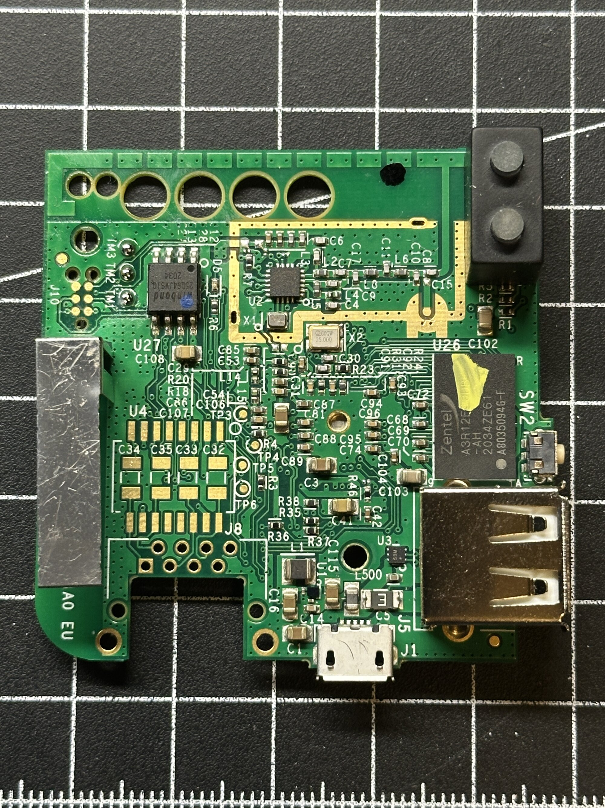
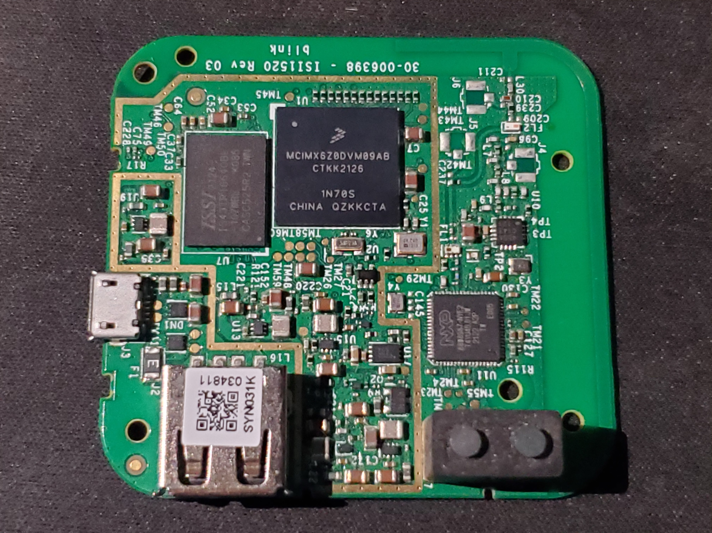

# Blink Sync Module 2 - Hardware Research

Reverse engineering notes for the Blink Sync Module 2. More than one board has shipped under this name, and they share almost nothing internally, so each hardware revision has its own folder.

## Hardware Revisions

| | [Rev A0](rev-a0-ar9331/) | [Rev 03](rev-03-imx6ulz/) |
|---|---|---|
| **PCB marking** | `ISI-1503-SA SYNC REV A0 EU` | `30-006398 - ISI1520 Rev 03` |
| **SoC** | Atheros AR9331 (MIPS) | NXP i.MX6ULZ (ARM Cortex-A7) |
| **RAM** | 64 MB DDR2 | 128 MB DDR3L |
| **Flash** | 8 MB SPI NOR | 32 MB QSPI NOR |
| **OS** | OpenWrt, Linux 4.14 | Vendor Linux (musl) |
| **U-Boot** | 1.1.4 | 2020.04, HAB secure boot |
| **Status** | Open: no shell yet | Locked down: signed boot and OTA |
| **Source** | Repository author | [ELECTROHAXZ](https://github.com/ELECTROHAXZ), [issue #1](https://github.com/luekker/blink-sync-module-2/issues/1) |

 

## Which Board Do I Have?

- **Open the case** and read the PCB marking, or compare against the photos in each folder
- **Over UART** (115200 baud), the U-Boot banner differs: `U-Boot 1.1.4` is Rev A0, `U-Boot 2020.04` is Rev 03

If you know a way to tell them apart without opening the case, please open an issue.

## Repository Layout

```
.
├── README.md
├── rev-a0-ar9331/      Rev A0: AR9331, OpenWrt
│   ├── README.md
│   ├── boot-logs/
│   ├── docs/
│   └── images/
└── rev-03-imx6ulz/     Rev 03: i.MX6ULZ, secure boot
    ├── README.md
    └── images/
```

## Related Projects

- [bling-wrt](https://github.com/lurume84/bling-wrt) - Customization for original Blink Sync Module (different hardware)
- [Blink Mini teardown](https://astrid.tech/2022/07/07/0/blink-mini-disassembly/) - Hardware analysis of Blink Mini camera
- [BlinkMonitorProtocol](https://github.com/MattTW/BlinkMonitorProtocol) - Reverse engineered cloud API documentation
- [Reversing Blink Cameras](https://www.brainonfire.net/blog/2023/10/21/reversing-blink/) - Uses Rev A0 board

## Contributing

Found additional information or corrections? Please open an issue or submit a pull request!

Have a board revision that isn't listed? Add a folder named `rev-<revision>-<soc>/` with its own `README.md` and `images/`, and add a column to the table above.

## Disclaimer

This project is for educational and research purposes only. Modifications to your Blink Sync Module may void warranty and could potentially damage the device. The author is not responsible for any damage to hardware or loss of functionality. This work is not affiliated with or endorsed by Blink or Amazon.
