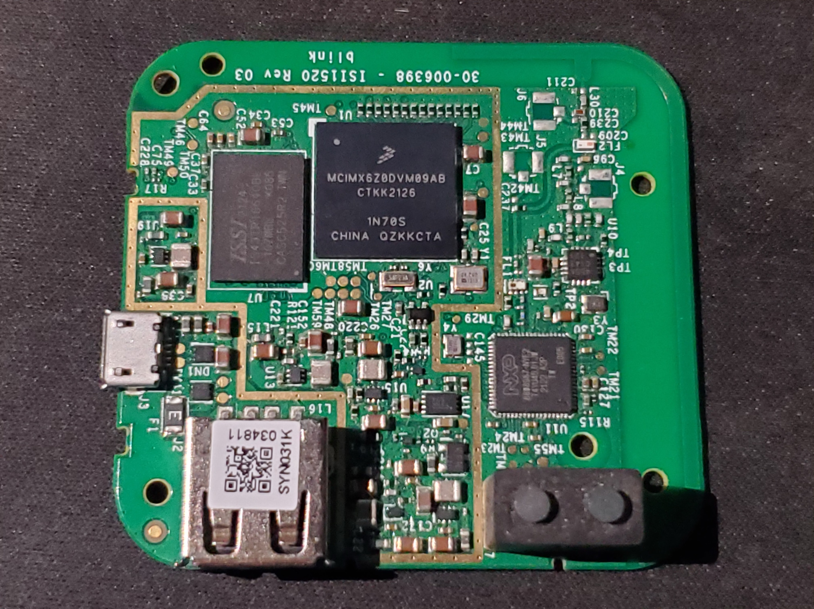
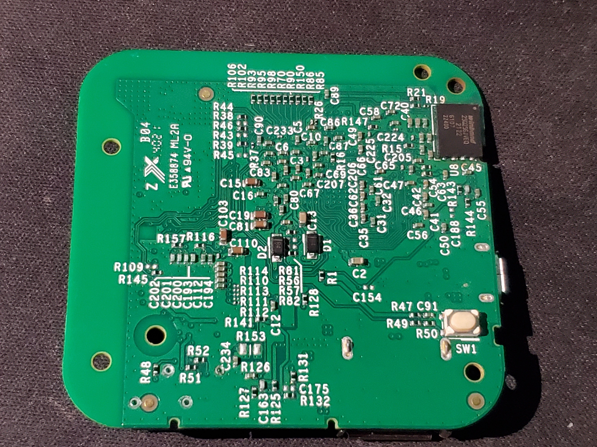

# Blink Sync Module 2 - Rev 03 (i.MX6ULZ) - Hardware Notes

[← Back to main README](../README.md)

> Contributed by [ELECTROHAXZ](https://github.com/ELECTROHAXZ) in [issue #1](https://github.com/luekker/blink-sync-module-2/issues/1). These findings have not been independently verified by the repository author.

## Overview
A second board sold as the Blink Sync Module 2. It looks similar at first glance but shares almost no hardware with [Rev A0](../rev-a0-ar9331/). Internal board name: `billy`.

**PCB marking:** `30-006398 - ISI1520 Rev 03`

 

## Hardware Specifications

- **SOC:** NXP i.MX6ULZ (`MCIMX6Z0DVM09AB`), ARM Cortex-A7 @ 900MHz
- **RAM:** 128 MB DDR3L, one 16-bit ISSI IS43TR16640BL [ISSI IS43TR16640BL Datasheet](https://www.issi.com/WW/pdf/43-46TR16640B-81280BL.pdf)
- **Flash:** 32 MB QSPI NOR. The contributor's notes say Micron N25Q256A, but the chip in the photo is marked Winbond `25Q256JVEQ` and U-Boot detects `w25q256`
- **WiFi/BT:** NXP 88W8987 SDIO module on usdhc1, powered from GPIO1_IO09
- **Sub-GHz Radio:** Silicon Labs Si4455, used for the camera link [Silicon Labs Si4455 Datasheet](https://www.silabs.com/documents/public/data-sheets/Si4455.pdf)
- **USB:** One host port, plus a second ChipIdea controller
- **Other:** 74HC595 shift register on bit-banged SPI for LEDs and control lines, button on GPIO1_IO03

## Flash Layout
Holds a HAB-signed U-Boot, then:
```
0x080000 - 0x580000 : FIT image (kernel), signed   (5 MB)
0x580000 - 0xe80000 : SquashFS rootfs              (9 MB)
0xea0000 - 0xeb0000 : read by U-Boot at boot, purpose not documented (64 KB)
```

## UART Access

- **Console:** UART1
- **Baud rate:** 115200
- **TX only:** A TX pad was found but no RX, so boot logs can be read but no commands can be sent. The pad location was not documented in the issue.

## Secure Boot (HAB)

The contributor flashed a custom OpenWrt image, which failed to boot with `failed to authenticate FIT image`. They then built a diagnostic image that kept the stock U-Boot, signed FIT, IVT and CSF but modified the signed rootfs, to read the `HAB SEC_CONFIG` eFuse:

```
U-Boot 2020.04-5.4.70-2.3.0-1+ge42dee801e (Apr 14 2023 - 13:30:26 +0000)

CPU:   i.MX6ULZ rev1.1 900 MHz (running at 396 MHz)
CPU:   Commercial temperature grade (0C to 95C) at 52C
Reset cause: POR
Model: i.MX6 ULZ 14x14 EVK Board
Board: Sync Module
DRAM:  128 MiB
MMC:   
In:    serial
Out:   serial
Err:   serial
Normal Boot button press  4sec
SF: Detected w25q256 with page size 256 Bytes, erase size 64 KiB, total 32 MiB
device 0 offset 0xea0000, size 0x10000
SF: 65536 bytes @ 0xea0000 Read: OK
device 0 offset 0x80000, size 0x500000
SF: 5242880 bytes @ 0x80000 Read: OK
device 0 offset 0x580000, size 0x900000
SF: 9437184 bytes @ 0x580000 Read: OK

Authenticate image from DDR location 0x82000000...

Secure boot enabled

HAB Configuration: 0xcc, HAB State: 0x99

--------- HAB Event 1 -----------------
event data:
    0xdb 0x00 0x24 0x42 0x33 0x18 0xc0 0x00
    0xca 0x00 0x1c 0x00 0x00 0xc5 0x1b 0x00
    0x00 0x00 0x0d 0x48 0x84 0x00 0x00 0x00
    0x00 0x5a 0x60 0x00 0x82 0x00 0x00 0x00
    0x00 0x2d 0x90 0x20

STS = HAB_FAILURE (0x33)
RSN = HAB_INV_SIGNATURE (0x18)
CTX = HAB_CTX_COMMAND (0xC0)
ENG = HAB_ENG_ANY (0x00)

Authenticate FIT image Fail, Please check
resetting ...
```

- `0xCC`: the i.MX6ULZ is in closed secure boot configuration
- `0x99`: the normal HAB state for a closed device
- `HAB_INV_SIGNATURE (0x18)`: an image signature failed authentication

The stock bootloader will not boot an unsigned kernel or OS such as OpenWrt. A modified FIT needs a signature trusted by the device's fused keys, which means Blink's private signing key.

## Firmware and OTA

- **OS:** Vendor-customised 32-bit ARM Linux using musl, a custom overlay root filesystem, and an MTD partition layout
- **OTA verification:** A `fwvalidate` binary checks firmware archives against a bundled RSA-3072 public key (`key0.der`) using RSA-PSS with SHA-256 and a 350-byte salt. The stock `sm.tar.gz` verifies; a one-byte change fails verification, so the rootfs cannot be modified through OTA.
- **Keys:** No private signing keys were found in the stock OS. Public keys were extracted.
- **Other:** Proprietary watchdog, radio, LED and sync interfaces, a few anti-tamper mechanisms, and JFFS2 persistent storage with versioned encryption and OTP-related decryption

## Conclusion

The contributor considers this revision reasonably secure and has stopped work on it. Custom firmware would need Blink's private signing key or an unknown exploit.

## Firmware Dump

The contributor shared an SPI flash dump in [issue #1](https://github.com/luekker/blink-sync-module-2/issues/1). It is **not** hosted in this repository and has not been verified. Treat it as untrusted.
